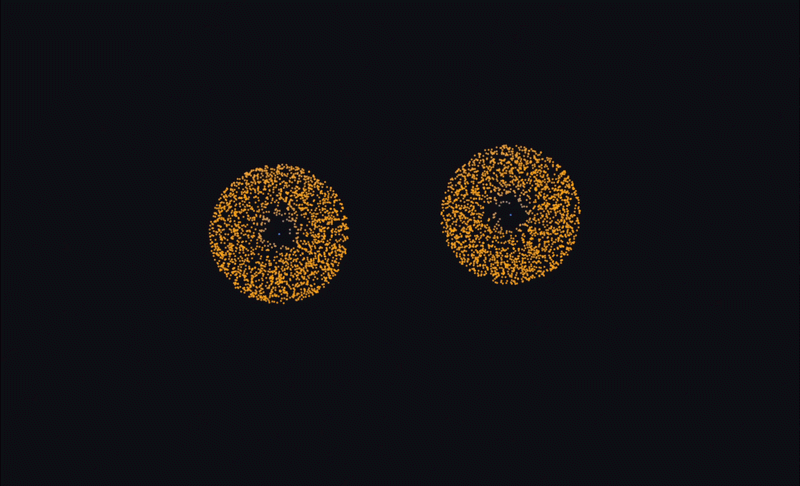

# gravitysim

> A real-time CUDA-accelerated N-body gravitational simulator with OpenGL visualization, three optimization tiers, and an OpenMP CPU fallback for laptop development.

[](LICENSE)
[](CMakeLists.txt)

A from-scratch all-pairs N-body simulator for studying CUDA optimization techniques. Particles attract each other under Newtonian gravity. The simulator ships three CUDA kernel variants (global memory, shared-memory tiling, packed `float4`) so you can profile each step of the optimization progression on the same scene. CUDA-OpenGL interop renders particles directly from the GPU buffer with no host round-trip. An OpenMP CPU path keeps the project usable on machines without an NVIDIA GPU (including macOS for development).



## Features

- Direct O(N²) gravity and Barnes-Hut octree gravity with Euler and Leapfrog integrators
- Three CUDA force kernels selectable at runtime: `global`, `tiled`, `float4`
- Zero-copy CUDA-OpenGL interop — kernels write to the rendered VBO directly
- OpenMP-parallel CPU backend for development without CUDA hardware
- Dear ImGui controls: pause / step / reset, dt / G / softening sliders, integrator / kernel / scenario pickers
- Optional collision merging on CPU and CUDA with mass and momentum conservation
- Built-in scenarios: random cluster, solar system, colliding galaxies
- Speed-coloured point sprites and optional per-particle trails with alpha blending
- Live FPS and particle-pairs/sec overlay
- Catch2 unit tests covering integrators, scenarios, and metrics — no GL/CUDA dependency

## Quick start

### Linux + NVIDIA (full path with CUDA)

```bash
git clone https://github.com/<user>/gravitysim.git
cd gravitysim
make build              # configure and compile, BUILD_CUDA defaults ON on Linux
./build/simulator core/config.toml
```

### macOS (CPU + OpenMP only)

CUDA does not run on modern macOS. The build automatically disables CUDA on Apple and uses the OpenMP CPU backend. `libomp` is required:

```bash
brew install libomp
git clone https://github.com/<user>/gravitysim.git
cd gravitysim
make build
./build/simulator core/config.toml
```

## Development

```bash
make check              # format + lint + typecheck + test
make test               # Catch2 unit tests (no GL/CUDA needed)
make build              # release build
make clean              # wipe build/
```

The test executable links only `sim_lib + scenarios_lib + metrics_lib + openmp_adapter` — never GL, GLFW, ImGui, or CUDA. This is enforced by the build, ensuring the lib/modules separation holds.

## Configuration

Startup-time knobs live in `core/config.toml` (window size, default particle count, integrator, kernel variant, max history). Runtime knobs (dt, G, paused, scenario selection) live in the ImGui panel.

The `[trails]` section sets whether trails start enabled and the number of simulation
samples retained per particle. The controls panel can toggle trails. History resets
with the scenario, advances with the simulation, and is disabled below two samples.

Enable **merge on collision** to combine overlapping bodies after each step. The
merge distance is a center-to-center threshold. Each connected group combines into
its lowest-ID particle, keeping that particle's trail and conserving total mass
and linear momentum. Detection samples the end of the step, so reduce `dt` for
fast-moving bodies that can pass through each other between samples.

Set `simulation.default_force = "barnes_hut"` or use the **force model** picker
to use the CPU/OpenMP octree. Barnes-Hut typically takes O(N log N) per force
evaluation. `simulation.barnes_hut_theta` controls the opening angle. Higher values
accept more approximations, and zero opens all branches. Switching from CUDA to
Barnes-Hut starts from the current positions and velocities.

`max_particles` is fixed at startup because the GL VBO is registered with CUDA once and cannot grow.

## Optimization progression

The three CUDA force kernels are separate `.cu` files under `core/src/lib/cuda/kernels/`. Switch between them at runtime via the `cuda kernel` dropdown to see the effect on `particle-pairs/sec` in the metrics overlay.

| Variant | File | Technique |
|---|---|---|
| `global` | `kernel_global.cu` | Naive O(N²); scalar global-memory loads |
| `tiled` | `kernel_tiled.cu` | Shared-memory tile of 256 bodies; `#pragma unroll 8` |
| `float4` | `kernel_float4.cu` | Packed `float4` (pos + mass) reads, `__restrict__`, FMA |

Speedup numbers from your hardware go in `docs/kernels.md` (run `nsys profile ./build/simulator` to populate).

## Export

Set either path under `[export]` in `core/config.toml` to enable capture:

```toml
[export]
positions = "capture/positions.jsonl"
frames = "capture/frames"
```

Paths are relative to the working directory. Use a new stream file and a new
frame directory for each run. The simulator captures the initial state, each
completed step, and each reset. Paused redraws add no samples. Each JSON line
contains `frame`, `run`, `step`, `time`, and `positions` as `[id, x, y, z]`
rows. The run counter increments on reset and IDs are stable within a run. The
matching `frame-NNNNNN.ppm` contains the scene before the controls and metrics
overlay. A minimized window may skip an image while the position stream continues.

## Deferred (future work)

- SPH fluid and electrostatic-charge variants

## License

MIT — see [LICENSE](LICENSE).
